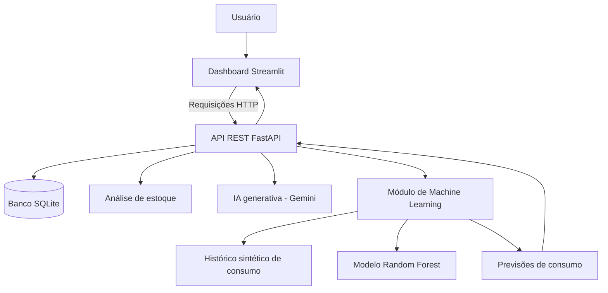

# 📦 StockMind AI

### Inteligência Artificial e Machine Learning aplicados à gestão inteligente de estoques

O **StockMind AI** é um projeto de inteligência artificial desenvolvido para demonstrar como APIs, Machine Learning e modelos de linguagem podem ser utilizados para apoiar o monitoramento e a gestão de estoques.

A aplicação permite acompanhar níveis de estoque, identificar produtos que exigem atenção, registrar movimentações, consultar históricos e gerar previsões de consumo utilizando um modelo de Machine Learning. Também conta com um assistente baseado em IA generativa para auxiliar na interpretação das informações disponíveis.

> **Status:** primeira versão funcional, com API REST, dashboard interativo, integração com IA generativa, modelo de previsão de demanda e testes automatizados.

---

## 🎯 Objetivo do projeto

Demonstrar a aplicação prática de técnicas de Engenharia de IA na construção de uma solução que combina processamento de dados, regras de negócio, previsão de demanda e IA generativa.

O projeto foi desenvolvido como uma aplicação demonstrativa para o contexto de gestão de estoques, incluindo um cenário fictício de insumos hospitalares.

## ✨ Funcionalidades

### 📊 Monitoramento inteligente de estoque

- Cadastro, consulta, atualização e exclusão de produtos.
- Monitoramento de quantidades disponíveis e níveis mínimos.
- Identificação de produtos com estoque baixo.
- Identificação de produtos vencidos ou próximos do vencimento.
- Identificação de possíveis excessos de estoque.
- Resumo dos principais indicadores de estoque.

### 🔄 Controle de movimentações

- Registro de entradas e saídas de produtos.
- Atualização automática do saldo após cada movimentação.
- Validação da disponibilidade antes de registrar uma saída.
- Histórico de movimentações com quantidade, motivo e saldo resultante.
- Proteção do histórico de auditoria, impedindo a exclusão de produtos que possuem movimentações registradas.

### 🤖 Assistente com IA generativa

- Geração de relatórios em linguagem natural a partir dos resultados da análise de estoque.
- Chat interativo para consultar informações e alertas.
- Envio de contexto de estoque para o modelo de linguagem.
- Tratamento de erros relacionados à indisponibilidade do serviço ou aos limites de utilização da API.

A IA generativa funciona como uma camada de apoio à interpretação das informações. Suas respostas devem ser verificadas antes de orientar decisões operacionais.

### 📈 Previsão de demanda com Machine Learning

- Geração de uma base histórica sintética de consumo.
- Engenharia de atributos temporais e variáveis de defasagem.
- Treinamento de um modelo `RandomForestRegressor`.
- Avaliação com métricas MAE e RMSE.
- Comparação com uma baseline baseada no consumo do dia anterior.
- Previsão recursiva de consumo para horizontes de 1 a 30 dias.
- Endpoint dedicado para consultar previsões.
- Visualização do histórico e das previsões no dashboard.

### 🧪 Testes automatizados

A suíte de testes valida regras de negócio, operações da API, movimentações de estoque e comportamentos do módulo de previsão.

**Última execução registrada:** 18 testes aprovados, sem falhas.

---

## 🏗️ Arquitetura

A aplicação está organizada em camadas para separar a interface, a API, a persistência de dados e os componentes de inteligência artificial.



### Componentes

| Componente | Responsabilidade |
|---|---|
| Streamlit | Interface interativa, indicadores, tabelas e gráficos |
| FastAPI | Exposição dos endpoints REST e validação das requisições |
| SQLite | Persistência do estoque e do histórico de movimentações |
| Pandas | Manipulação e preparação dos dados |
| Scikit-learn | Treinamento e avaliação do modelo de previsão |
| Random Forest | Estimativa do consumo futuro |
| Gemini API | Geração de relatórios e respostas em linguagem natural |
| Pytest | Testes automatizados |

---

## 🛠️ Tecnologias utilizadas

- **Linguagem:** Python
- **API:** FastAPI
- **Interface:** Streamlit
- **Banco de dados:** SQLite
- **Manipulação de dados:** Pandas, NumPy
- **Machine Learning:** Scikit-learn
- **Persistência do modelo:** Joblib
- **IA generativa:** Google Gemini API (`google-genai`)
- **Comunicação HTTP:** Requests
- **Validação de dados:** Pydantic
- **Testes:** Pytest
- **Controle de versão:** Git e GitHub

---

## 📁 Estrutura do projeto

```text
stockmind-ai/
├── app/
│   ├── __init__.py
│   ├── main.py
│   ├── database.py
│   ├── inventory.py
│   ├── agent.py
│   └── dashboard.py
├── data/
│   ├── inventory.json
│   └── stockmind.db
├── ml/
│   ├── __init__.py
│   ├── data/
│   │   ├── generate_dataset.py
│   │   └── historical_consumption.csv
│   ├── models/
│   │   ├── demand_forecasting.joblib
│   │   └── evaluation_metrics.csv
│   ├── notebooks/
│   ├── train.py
│   ├── predict.py
│   └── evaluate.py
├── tests/
│   ├── __init__.py
│   ├── test_inventory.py
│   ├── test_inventory_api.py
│   └── test_ml_prediction.py
├── .env.example
├── .gitignore
├── requirements.txt
└── README.md
```

*Observação: a estrutura acima representa a organização prevista para o projeto. Arquivos vazios ou ainda não implementados, como `ml/evaluate.py`, não devem ser considerados funcionalidades concluídas.*

---

## ⚙️ Pré-requisitos

Antes de executar a aplicação, tenha instalado:

- Python 3.13 ou uma versão compatível com as dependências do projeto.
- Git, caso deseje clonar o repositório.
- Uma chave de API do Google Gemini para utilizar as funcionalidades de IA generativa.

A aplicação pode ser executada localmente no Windows, utilizando o terminal do VS Code, PowerShell ou Git Bash.

## 🚀 Instalação e execução

### 1. Clone o repositório

```bash
git clone <URL_DO_REPOSITORIO>
cd stockmind-ai
```

Substitua `<URL_DO_REPOSITORIO>` pela URL real do repositório.

Se o projeto já estiver na sua máquina, entre diretamente na pasta `stockmind-ai`.

### 2. Crie o ambiente virtual

```bash
python -m venv .venv
```

### 3. Ative o ambiente virtual

No Git Bash:

```bash
source .venv/Scripts/activate
```

No PowerShell:

```powershell
.\.venv\Scripts\Activate.ps1
```

### 4. Instale as dependências

```bash
python -m pip install -r requirements.txt
```

### 5. Configure a chave da API Gemini

Crie um arquivo `.env` na raiz do projeto, no mesmo nível de `requirements.txt`, e adicione:

```dotenv
GEMINI_API_KEY=sua_chave_api_aqui
```

Substitua `sua_chave_api_aqui` pela sua chave real.

**Importante:** nunca publique o arquivo `.env`, sua chave de API ou outros segredos no GitHub. Confira se o `.gitignore` exclui esse arquivo. O `.env.example` deve conter apenas um valor ilustrativo, sem credenciais reais.

### 6. Inicie a API

Na raiz do projeto, com o ambiente virtual ativado:

```bash
python -m uvicorn app.main:app --reload
```

A API estará disponível em:

`http://127.0.0.1:8000`

A documentação interativa estará disponível em:

`http://127.0.0.1:8000/docs`

Mantenha esse terminal aberto enquanto utiliza a aplicação.

### 7. Inicie o dashboard

Abra um segundo terminal, entre na pasta do projeto e ative o ambiente virtual, se necessário.

Execute:

```bash
python -m streamlit run app/dashboard.py
```

O Streamlit disponibilizará o dashboard no navegador. Se a página não abrir automaticamente, utilize o endereço informado no terminal.

### 8. Execute os testes

Na raiz do projeto:

```bash
python -m pytest -v
```

A suíte de testes cobre as regras de negócio do estoque, os endpoints e as previsões de Machine Learning.

---

## 🔌 Principais endpoints da API

A API disponibiliza operações de estoque, análise de riscos, movimentações, assistente de IA e previsão de consumo.

| Método | Endpoint | Descrição |
|---|---|---|
| `GET` | `/` | Informações básicas da aplicação |
| `GET` | `/health` | Verificação de saúde da API |
| `GET` | `/inventory` | Consulta os produtos |
| `GET` | `/inventory/analyze` | Analisa os riscos do estoque |
| `GET` | `/inventory/ai-analysis` | Gera relatório com IA generativa |
| `POST` | `/inventory/chat` | Envia uma pergunta ao assistente |
| `POST` | `/inventory` | Cadastra um produto |
| `PATCH` | `/inventory/{item_id}` | Atualiza um produto |
| `DELETE` | `/inventory/{item_id}` | Exclui um produto conforme as regras de negócio |
| `POST` | `/inventory/{item_id}/movements` | Registra uma entrada ou saída |
| `GET` | `/inventory/{item_id}/movements` | Consulta movimentações de um produto |
| `GET` | `/movements` | Consulta o histórico de movimentações |
| `GET` | `/inventory/summary` | Retorna indicadores do estoque |
| `GET` | `/ml/forecast/{product_id}` | Prevê o consumo de um produto |

Os endpoints e seus parâmetros podem ser consultados na documentação interativa em `/docs`.

### Exemplo: previsão de consumo

Requisição:

```http
GET /ml/forecast/1?horizon=7
```

Esse exemplo solicita a previsão de sete dias para o produto de ID `1`.

A resposta contém o identificador do produto, o horizonte solicitado, as estimativas diárias e o consumo total previsto para o período.

Os IDs correspondem aos produtos da base de dados utilizada pelo modelo. Para consultar os produtos disponíveis, utilize `GET /inventory`.

---

## 🧠 Machine Learning: previsão de demanda

O módulo de Machine Learning estima o consumo futuro de cada produto com base em uma série temporal sintética.

### Preparação dos dados

O dataset é gerado pelo script `ml/data/generate_dataset.py`. Ele contém registros diários para cinco categorias fictícias de insumos, com variações temporais e aleatoriedade controlada para permitir a reprodução dos experimentos.

As principais colunas incluem:

- `date`: data do registro.
- `product_id`: identificador do produto.
- `product_name`: nome do produto.
- `consumption`: consumo registrado ou simulado.
- `day_of_week`: dia da semana.
- `month`: mês.
- `is_weekend`: indicador de fim de semana.

O treinamento também utiliza atributos derivados do histórico:

- `lag_1`: consumo do dia anterior.
- `lag_7`: consumo de sete dias antes.
- `rolling_mean_7`: média móvel de sete dias.

### Treinamento

Para treinar o modelo com o dataset existente, execute:

```bash
python ml/train.py
```

O processo utiliza uma divisão temporal dos dados por produto: os registros iniciais são usados para treinamento e os períodos posteriores para avaliação.

O modelo treinado é salvo em:

```text
ml/models/demand_forecasting.joblib
```

As métricas são salvas em:

```text
ml/models/evaluation_metrics.csv
```

### Geração de previsões

O script de previsão pode ser executado com:

```bash
python ml/predict.py
```

O módulo permite consultar previsões para diferentes produtos e horizontes de até 30 dias.

O endpoint de previsão utiliza o modelo salvo e o histórico disponível no dataset. Por isso, a data inicial das previsões depende da última data registrada na base histórica utilizada.

### Avaliação experimental

Na execução registrada do treinamento, os resultados foram:

| Modelo | MAE | RMSE |
|---|---:|---:|
| Random Forest | 6,495 | 9,203 |
| Baseline — dia anterior | 10,150 | 14,034 |

O MAE (Mean Absolute Error) mede o erro absoluto médio das previsões. O RMSE (Root Mean Squared Error) penaliza mais fortemente erros de maior magnitude.

Nesse experimento, o Random Forest apresentou:

- Aproximadamente **36% menos MAE** que a baseline.
- Aproximadamente **34,4% menos RMSE** que a baseline.

Esses resultados indicam que o modelo superou a baseline no conjunto de teste utilizado.

**Limitação importante:** os dados são sintéticos e não representam medições reais de consumo hospitalar. Portanto, as métricas servem para demonstrar o processo experimental e comparar os modelos nesse dataset, mas não comprovam desempenho em ambientes reais.

---

## 🧪 Testes automatizados

O projeto utiliza Pytest para verificar o comportamento de suas principais funcionalidades.

Para executar todos os testes:

```bash
python -m pytest -v
```

Para executar apenas os testes de estoque:

```bash
python -m pytest tests/test_inventory.py -v
```

Para executar os testes da API:

```bash
python -m pytest tests/test_inventory_api.py -v
```

Para executar os testes de previsão:

```bash
python -m pytest tests/test_ml_prediction.py -v
```

### Último resultado registrado

```text
18 passed, 1 warning
```

Os 18 testes passaram sem falhas. O aviso registrado está relacionado à depreciação do uso de `httpx` no `TestClient` do Starlette e não impediu a execução dos testes.

---

## 🔐 Segurança e limitações

- As credenciais da API Gemini devem ser configuradas por variável de ambiente.
- O arquivo `.env` não deve ser versionado.
- Os dados do projeto são fictícios e destinados a demonstração.
- As previsões de consumo não substituem análises operacionais ou validações com dados reais.
- As respostas geradas por IA podem conter erros e devem ser revisadas.
- A disponibilidade do assistente depende dos limites de utilização e da disponibilidade da API Gemini.
- A aplicação, nesta versão, foi desenvolvida para execução local; disponibilidade pública, autenticação de usuários e implantação em produção exigem configurações adicionais.

---

## 🔮 Próximas melhorias

Possíveis evoluções para versões futuras:

- Validar o modelo com dados históricos reais e autorizados.
- Comparar diferentes algoritmos de previsão de demanda.
- Adicionar intervalos de incerteza às previsões.
- Desenvolver alertas de risco de ruptura de estoque.
- Avaliar políticas de reposição considerando consumo, estoque disponível e prazo de entrega.
- Implementar autenticação e controle de acesso.
- Implantar a aplicação em um ambiente de nuvem.
- Publicar o modelo com documentação técnica e model card.
- Adicionar monitoramento de desempenho e qualidade das previsões.

Essas melhorias são propostas futuras e não fazem parte necessariamente da versão atual.

---

## 👩‍💻 Sobre o projeto

O StockMind AI explora a integração entre desenvolvimento de software, APIs, análise de dados, Machine Learning e IA generativa em uma aplicação demonstrativa voltada à gestão de estoques.

O objetivo é demonstrar não apenas o treinamento de um modelo, mas também sua integração a uma aplicação funcional, com interface, persistência, endpoints documentados e testes automatizados.

---

**Desenvolvido como projeto de portfólio em Engenharia de Software e Inteligência Artificial.**